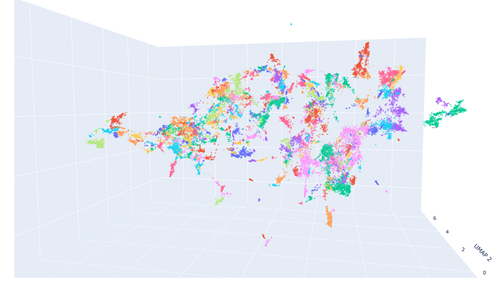

# Кластеризация сообщений из чата поддержки

Чат-бот не всегда понимает, что хочет клиент, и переводит его на оператора. Проект группирует такие сообщения по смыслу: так видно, о чём клиенты пишут чаще всего, и находятся новые формулировки, которых не хватает интентам бота. Аналогично этот подход можно применить к поисковой строке, для поиска ключевых слов / фраз для настройки выдачи.

**Стек:** Python - Transformers (multilingual-e5-large), UMAP, HDBSCAN, scikit-learn

Каждая точка — сообщение, цвет — кластер.

## Как работает

1. **Сообщения → векторы.** Каждое сообщение переводится в вектор предобученной мультиязычной моделью multilingual-e5-large. Похожие по смыслу фразы получают близкие векторы, даже если написаны разными словами: «позовите оператора» и «соедините со специалистом» окажутся рядом.
2. **Кластеризация.** Векторы длиной 1024 плохо кластеризуются напрямую, поэтому сначала UMAP сжимает их до 50 измерений, сохраняя соседство похожих сообщений. Затем HDBSCAN ищет плотные группы. Число кластеров заранее задавать не нужно, а сообщения, которые никуда не подошли, помечаются как шум — туда попадает большая часть мусора.
3. **Разметка кластеров.** Для каждого кластера берутся 10 сообщений, ближайших к его центру: по ним видно, о чём кластер, и ему вручную даётся название. Для наглядности строится интерактивный 3D-график, где при наведении на точку видно текст сообщения.
4. **Поиск новых формулировок.** Сообщения из нужных кластеров сравниваются с примерами из существующих интентов двумя способами: по словам (TF-IDF после приведения слов к начальной форме) и по смыслу (близость векторов). Те, что не похожи ни на один пример, — кандидаты в новые формулировки для интентов.

## Результат

- Около 31 тыс. сообщений разбились примерно на 300 кластеров, ещё около 17% ушло в шум.
- Кластеры получились осмысленными: отдельные темы запросов и отдельно служебные фразы вроде «позовите оператора», которые легко отсеять целиком.
- В одной из тем после фильтрации осталось около половины сообщений — это новые формулировки, включая опечатки и редкие сценарии, которых нет в интентах.

На выходе получаются таблица «сообщение → кластер», типичные фразы каждого кластера, 3D-визуализация и список кандидатов в новые формулировки.

Примеры сообщений и кластеров показать не могу: это переписка реальных клиентов, поэтому в репозитории только код.
