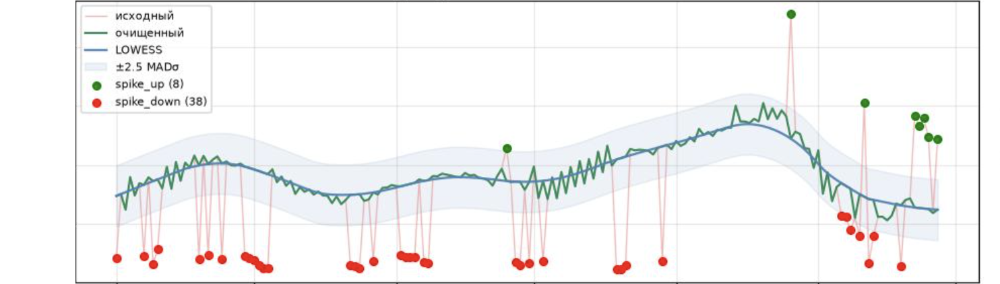
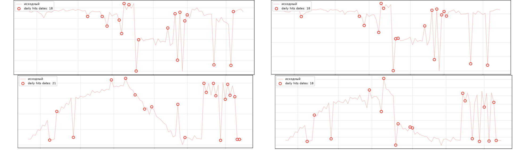
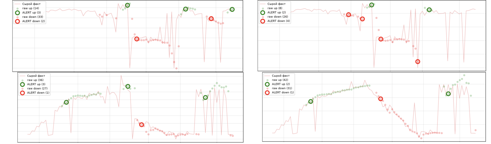

# AutoAlert: алертинг продуктовых метрик

На момент разработки в моей команде (как и в ближайшем окружении) нет удобного инструмента, который в автоматическом режиме ежедневно отслеживает поведение метрик — как в целом по продукту, так и по отдельным кампаниям. Это замедляет реагирование на критические события и заставляет аналитика тратить время на ручной мониторинг. Проект закрывает эту брешь и ускоряет реакцию на изменения в поведении выбранных метрик.

Фактически это proof of concept — проверка, что данный подход вообще будет показывать удовлетворительные результаты при минимуме усилий и быстроте.

Вот примерно с такими рядами мне пришлось работать. На графике пример работы кода (при одиночном запуске)

## Задача

Ноутбук принимает на вход набор метрик (датасетом) и по каждой даёт краткую сводку на текущий день. Рассматриваются две самые частые ситуации — резкий и плавный сдвиг уровня.

Какие варианты решения проблемы реагирования на критические события используются на момент разработки:

- **Еженедельная встреча**, где проходимся по отчётам и идущим тестам. Единственный способ проверить, что всё ок, но встреча проходит раз в неделю (и то не всегда), что откладывает реакцию на неделю, плюс ко всему человеческий фактор.
- **Мониторинг в платформе A/B-тестов.** Присылает уведомления о проблемах с покрытием и работой сценариев, но не даёт информации о других метриках: покрытие может быть стабильным и сценарии могут выполняться без ошибок, а коммуникаций уходит всё меньше. Кампании, которых нет в платформе, не мониторятся.
- **Алерты системы рассылок.** Снова может произойти кейс, когда все вроде бы работает, но потихоньку умирает.

## Что делает инструмент

На вход подаётся одна или несколько метрик — в теории их число не ограничено — в виде таблицы `data/metrics.csv`:

| Колонка | Пример | Комментарий |
|---|---|---|
| `date` | 2026-01-01 | кроме дневной гранулярности можно использовать недельную или месячную, если хватает данных |
| `metric` | CR в доставку | название метрики |
| `value` | 0.8531 | значение |
| `channel` | Воронка | кодовое название, которое разграничивает пулы метрик |

На выходе — сводка по каждой метрике:

| Колонка | Пример | Комментарий |
|---|---|---|
| `channel` | Воронка | пул метрик |
| `metric` | CR в доставку | название метрики |
| `status_code` | alert | alert или norm |
| `status_nm` | Выброс вниз | выброс вверх / вниз, плавный сдвиг вверх / вниз, в пределах нормы |
| `fact` | 0.78 | фактическое значение метрики на сегодня |
| `delta` | -0.08 | разница между фактом и ожиданием |
| `delta_dyn` | -0.15 | изменение ожидаемого уровня за N дней |

Ежедневная сводка может записываться в историческую витрину, так что её можно встроить в отчётность, и уходит ботом в рабочий чат.

## Техническая реализация

Фундамент инструмента — алгоритм LOWESS (локально взвешенное сглаживание) — метод непараметрической регрессии, который строит плавную линию тренда через зашумлённые данные, подгоняя простые полиномы в окрестности каждой точки.

Аномалии размечаются через порог отклонения от MAD (медианное абсолютное отклонение) — робастной меры разброса. В отличие от стандартного отклонения, MAD устойчив к единичным экстремальным значениям, потому что считается через медиану, а не среднее.

**Плюсы:**

- простота интерпретации;
- простота реализации и скорость расчётов — важно, когда рядов много;
- возможность тонкой подгонки под конкретный ряд (правда, для этого нужны заранее размеченные аномалии);
- неплохие результаты.

**Минусы:**

- чувствителен к резким изменениям тренда;
- сильные краевые эффекты: на краю ряда соседи у точки есть только с одной стороны;
- из-за этого может давать частые ложные срабатывания;
- не видит плавных изменений тренда — когда метрика медленно снижается без резких скачков.

Последний пункт решает второй алгоритм: он сравнивает тренд N дней назад с текущим. Алерт уходит, если сигнал держится три дня подряд.

Параметры для тонкой настройки:

| Параметр | Сейчас | Что делает | Если увеличить | Если уменьшить |
|---|---|---|---|---|
| `smooth_fraction` | 0.17 | доля ряда в локальном окне LOWESS | линия глаже, меньше шума, тренды медленнее | линия чувствительнее, быстрее реагирует, но больше шума |
| `iterations` | 6 | количество итераций LOWESS внутри tsmoothie | более робастное сглаживание, но медленнее | быстрее, но менее устойчиво |
| `passes` | 3 | сколько раз чистим выбросы и пересглаживаем | лучше подавляет выбросы перед финальным LOWESS | меньше чистки, выбросы сильнее влияют на сглаживание |
| `clean_sigma` | 2.5 | ширина интервала при внутренней очистке | меньше точек считаются плохими | больше точек заменяется |
| `n_sigma` | 2 | основной порог аномалии по MAD-score | аномалий меньше | аномалий больше |
| `trend_lookback_days` | 7 | с чем сравниваем текущий LOWESS | тренд более долгосрочный | тренд более краткосрочный |
| `trend_pct_threshold` | 0.05 | минимальное относительное изменение | меньше срабатываний | больше срабатываний |
| `confirm_days` | 3 | сколько дней подряд нужен сигнал для алерта | меньше ложных алертов, но позже | быстрее, но больше ложных |

## Моделирование на реальном тесте

Для проверки я взял один из тестов, который ещё шёл на момент написания. Тест примечателен тем, что во время него было несколько критических проблем с отправкой коммуникаций.

Инструмент отрабатывал на исторических данных с шагом в один день и помечал дни, которые были на правом краю данных и, по его мнению, аномальными. Так воспроизводилась работа ноутбука по регламенту. Параметры — рекомендуемые.

Выбросы при ежедневном запуске на метриках воронки. Сверху — покрытие (доля доставленных от запланированных) и конверсия в отправку, снизу — число запланированных и отправленных коммуникаций. Кружки — дни, которые детектор отметил бы в тот же день.

Отмеченные дни в целом совпадают с реальными аномалиями. Доля ложноположительных срабатываний не нулевая, но и не критичная.

Алерты плавного сдвига на тех же метриках. Сверху — покрытие и конверсия в отправку, снизу — число отправленных и запланированных коммуникаций. Кольца — алерты, бледные точки — дневные сигналы.

Детектор плавного снижения и роста тоже отработал неплохо: все алерты примерно попадают на участки с плавным или устойчивым изменением.

## Почему не ML?

- В тестах ряды относительно короткие (~30–300 точек) — этого недостаточно, чтобы обучить, например, автоэнкодер.
- Ряды шумные (необязательно, но в том числе), а с этим большинство моделей справляется плохо.
- Без разметки истинных аномалий модель не обучить, а модели без обучения показывают неудовлетворительные результаты.
- Модели, даже предобученные, работают на порядок медленнее.

## Какие в итоге выводы?

- Получилось получить рабочий прототип, открытый для модификаций и доработок
- В перспективе масштабирования его использования с аналитоков снимется потребность каждый день мониторить множество отчетов и пр.